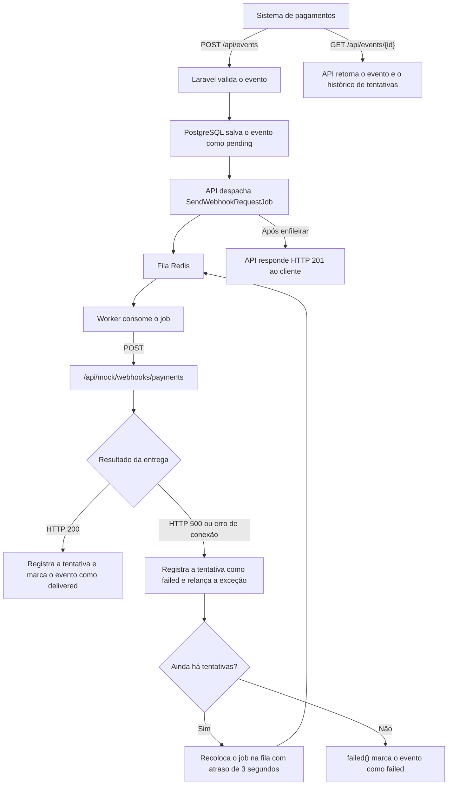

# Webhook Delivery Service

API Laravel que recebe eventos de pagamento e demonstra a entrega assíncrona de webhooks. O produtor registra um evento, como `payment.approved`, e recebe o ID gerado pela API. A entrega é processada em segundo plano e o resultado pode ser consultado pelo mesmo ID.

A implementação atual envia um POST com corpo vazio para um destino simulado na própria aplicação. A URL do job inclui `?simulate=error` para demonstrar os retries com HTTP 500.

## Como a fila funciona

1. O controller valida a requisição e o serviço grava o evento em `events` com status `pending`. O serviço despacha `SendWebhookRequestJob` com o ID do evento. Depois de enfileirar o job, a API responde com HTTP 201.
2. Na configuração Redis, um worker consome o job da fila `default`. O job usa o cliente HTTP do Laravel para chamar o mock.
3. O job registra o resultado em `delivery_attempts`, com número da tentativa, URL, código e mensagem da resposta ou da exceção. Em caso de sucesso, atualiza o evento para `delivered`.
4. Quando recebe HTTP 500, `$response->throw()` lança uma exceção. O `catch` registra a tentativa como `failed` e relança a exceção com `throw $e`. Assim, o worker detecta a falha e agenda outra execução enquanto houver tentativas disponíveis.
5. O limite é de **5 tentativas no total**, com **3 segundos de atraso** antes de cada retry. Enquanto aguarda, o evento permanece `pending`. Quando as tentativas se esgotam, o Laravel chama `failed()` e o evento passa para `failed`.

O Redis armazena os jobs enfileirados. O PostgreSQL mantém os eventos e o histórico de cada entrega. O Laravel Horizon executa e monitora os workers da fila Redis. O painel local fica em `/horizon`.

## Endpoints

| Método e rota | Comportamento |
| --- | --- |
| `POST /api/events` | Cria um evento e enfileira a entrega. Retorna `201` com o evento criado ou `422` para dados inválidos. |
| `GET /api/events/{id}` | Retorna o evento e suas tentativas em `delivery_attempts`. Retorna `404` se o ID não existir. |
| `POST /api/mock/webhooks/payments` | Simula o destino do webhook. Retorna `200` por padrão ou `500` com `?simulate=error`. |
| `GET /api/user` | Retorna o usuário autenticado pelo Laravel Sanctum. |

No `POST /api/events`, `type` é uma string obrigatória. `amount` é numérico e opcional. `occurred_at` é uma data opcional e assume o horário atual quando omitido.

## Tecnologias e bibliotecas

| Tecnologia | Uso |
| --- | --- |
| PHP 8.4 e Laravel 13 | API REST, validação, persistência com Eloquent, cliente HTTP e processamento de filas. |
| PostgreSQL 15 e Redis 7 | Banco de dados e fila, respectivamente, provisionados pelo Docker Compose. |
| Laravel Horizon 5 | Execução e monitoramento dos workers Redis. |
| Laravel Sanctum 4 | Autenticação da rota `/api/user`. |
| Laravel Tinker e Pail | Console interativo e acompanhamento de logs. |
| Pest 5, plugin Laravel para Pest, Faker e Mockery | Ferramentas de teste, geração de dados e mocks. |
| Laravel Pint e Laravel Boost | Formatação PHP e ferramentas de apoio ao desenvolvimento. |

## Executar localmente com PostgreSQL e Redis

Instale as dependências com `composer install` e copie `.env.example` para `.env` se o arquivo ainda não existir. Configure `DB_USERNAME` e `DB_PASSWORD` no `.env` com as credenciais que o Docker Compose usará para criar o banco e ajuste as seguintes variáveis:

```dotenv
APP_URL=http://127.0.0.1:8000
DB_CONNECTION=pgsql
DB_HOST=127.0.0.1
DB_PORT=5439
DB_DATABASE=webhook
QUEUE_CONNECTION=redis
REDIS_CLIENT=phpredis
REDIS_HOST=127.0.0.1
REDIS_PORT=6379
```

O `.env.example` vem com SQLite e fila no banco. Os valores acima habilitam o fluxo Redis do diagrama. O PHP local precisa das extensões `pdo_pgsql` e `redis`.

```bash
docker compose up -d db redis
php artisan key:generate --no-interaction
php artisan migrate --no-interaction
php artisan serve --host=127.0.0.1 --port=8000 --no-interaction
```

Em outro terminal, inicie o Horizon com `php artisan horizon --no-interaction`. Para consumir a fila sem o painel, use `php artisan queue:work redis --no-interaction` como alternativa.

### Testar a entrega

```bash
curl -i -X POST http://127.0.0.1:8000/api/events \
  -H 'Accept: application/json' \
  -H 'Content-Type: application/json' \
  -d '{"type":"payment.approved","amount":150.00,"occurred_at":"2026-11-21T15:00:00Z"}'
```

Use o `id` da resposta para consultar o evento. O exemplo usa o ID `1`.

```bash
curl http://127.0.0.1:8000/api/events/1
```

Com a configuração atual do job, o mock retorna HTTP 500. Consulte o evento para acompanhar as tentativas e ver o status final `failed`. Para testar uma entrega bem-sucedida, remova `?simulate=error` da URL em [SendWebhookRequestJob.php](app/Jobs/SendWebhookRequestJob.php), reinicie o processo que consome a fila e crie um novo evento.
